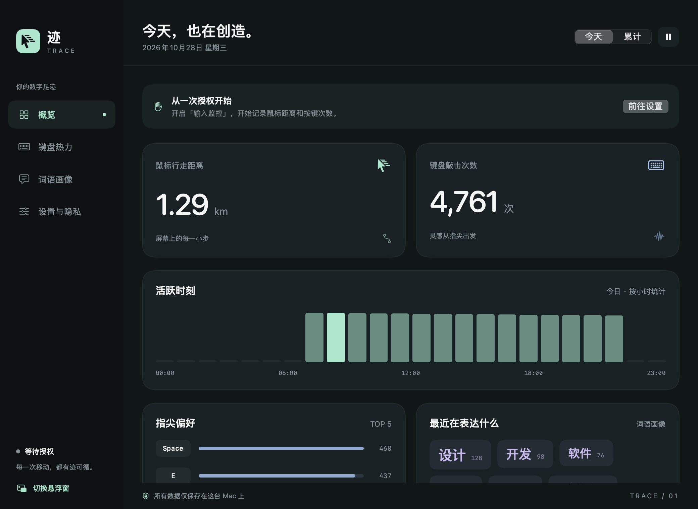
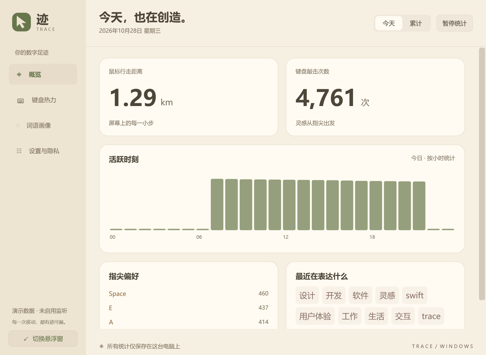
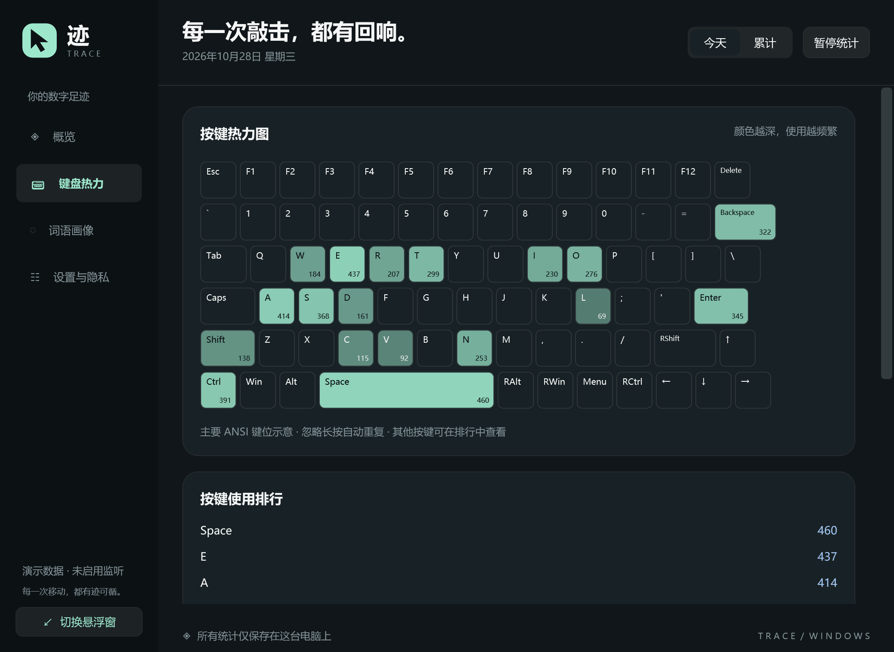
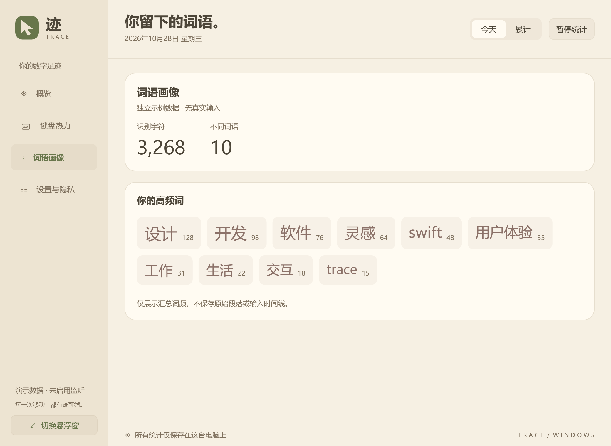

<div align="center">

# 迹 · Trace

**把每天的键盘与鼠标活动，变成看得见的数字足迹。**

原生桌面统计工具（macOS / Windows） · 淡木 / 夜色双主题 · 轻量悬浮窗 · 本地保存


[](LICENSE)

[macOS 下载](https://github.com/aiyougit/trace-macos/releases/tag/v0.3.0) · [Windows 下载](https://github.com/aiyougit/trace-macos/releases/tag/windows-v0.1.0) · [macOS 指南](docs/使用指南.md) · [Windows 指南](windows/README.md) · [更新日志](CHANGELOG.md) · [参与贡献](CONTRIBUTING.md)


</div>

> 所有截图均由独立预览工具生成，使用虚构演示数据，不含个人输入记录。预览进程不启用监听，因此截图中的授权提示不代表正式运行时的状态。

## 它能做什么

- **桌面悬浮条**：220 × 44 点，只显示当天鼠标移动距离与键盘输入次数，可拖动、右键操作，轻微透明的背景（macOS 使用原生磨砂，Windows 使用半透明背景）。
- **活动概览**：查看今天 / 累计数据，以及每小时的键盘活动分布。
- **键盘热力图**：用颜色和排行了解每个按键的使用频率。
- **中英文词语画像**：可选开启，通过系统分词查看高频词与字符统计。
- **两种外观**：清淡的奶油黄木色「浅色 · 淡木」，以及薄荷点缀的「深色 · 夜色」，面板与悬浮条同步切换并记住选择。
- **自然的窗口行为**：统计面板正常显示，只有悬浮条置顶；最小化、关闭面板或切换其他应用时自动收起。macOS 支持 Dock / 菜单栏，Windows 支持任务栏 / 系统托盘。
- **本地数据管理**：暂停统计、排除指定应用、导出 JSON、清空画像或全部统计。

macOS 使用 SwiftUI、AppKit、CoreGraphics、Accessibility 与 NaturalLanguage；Windows 使用 .NET 10 / WPF、Win32、UI Automation 与 本地词典分词。两端均采用原生桌面实现，**统计留在本机，不发起网络请求**。Windows 安装包自带 .NET 运行时。

## 界面预览

### 小巧的悬浮条

只留两个数字，让桌面保持清爽。下图为 Retina 预览，实际尺寸为 220 × 44 点；原生磨砂的实际观感随桌面背景和系统设置变化。

| 浅色 · 淡木 | 深色 · 夜色 |
| --- | --- |
|  |  |

### 键盘热力与词语画像

| 按键频率 | 中英文词频 |
| --- | --- |
|  |  |

<details>
<summary>查看深色主题概览</summary>



</details>

### Windows 原生版本



| Windows 键盘热力（夜色） | Windows 词语画像（淡木） |
| --- | --- |
|  |  |

| Windows 淡木悬浮条 | Windows 夜色悬浮条 |
| --- | --- |
|  |  |

这些图片由 Windows 上的 WPF 渲染工具生成，使用虚构数据，不开启监听。Windows 版的架构、兼容性与采样边界见 [Windows 使用指南](windows/README.md)。

## 下载与安装

| 平台 | 系统要求 | 架构 | 下载 |
| --- | --- | --- | --- |
| macOS 0.3.0 | macOS 13+ | Apple Silicon / Intel 通用 | [PKG / APP ZIP](https://github.com/aiyougit/trace-macos/releases/tag/v0.3.0) |
| Windows 0.1.0 | Windows 10 22H2 / Windows 11 | x64 / ARM64 分别下载 | [EXE 安装器 / 便携 ZIP](https://github.com/aiyougit/trace-macos/releases/tag/windows-v0.1.0) |

### macOS

支持 **macOS 13 Ventura 及以上**，同一个通用安装包兼容 **Apple Silicon 和 Intel Mac**。

1. 打开 [macOS 版本 Releases](https://github.com/aiyougit/trace-macos/releases/tag/v0.3.0)，下载 `Trace-0.3.0-universal.pkg`。
2. 退出正在运行的 Trace，双击安装包，按 macOS 安装器提示完成安装。应用固定安装到 `/Applications/Trace.app`。
3. 从「应用程序」启动 Trace，按照下面的说明开启需要的权限。

也提供 `Trace-0.3.0-universal.app.zip`，解压后将 `Trace.app` 拖到「应用程序」即可。两种方式任选其一。更新安装不会主动删除已有统计；安装包不带后台服务、开机启动或隐私授权修改脚本。

**当前为社区预览版**：应用采用 ad-hoc 临时签名，安装包尚未进行 Developer ID 签名和 Apple 公证。macOS 可能拦截下载的应用或安装包；请核对仓库来源及 Release 中的 SHA-256 校验文件，并按系统「隐私与安全性」中提供的官方方式决定是否允许打开。没有可用的允许入口时，可以从源码构建。不需要关闭 Gatekeeper 或系统完整性保护。

校验下载文件：

```sh
cd ~/Downloads
shasum -a 256 -c SHA256SUMS.txt
```

校验文件对应同一 Release 的 `.pkg` 与 `.app.zip`，请将它们放在同一目录。

### Windows

常见 Intel / AMD 电脑选择 `Trace-0.1.0-windows-x64-setup.exe`，ARM 电脑选择 `Trace-0.1.0-windows-arm64-setup.exe`。也提供对应架构的便携 ZIP，解压后运行 `Trace.exe`。安装器按当前用户安装，不需要单独安装 .NET、不设置开机启动；更新及卸载不会主动删除统计。

首次运行即可开始基础统计，词语画像默认关闭。主面板收起后保留任务栏入口，也可通过托盘双击展开。Windows 不使用下面的 macOS 权限页；普通用户权限无法读取的窗口和安全桌面会跳过。

当前 Windows EXE / 安装器未进行商业代码签名，可能出现 SmartScreen 或未知发布者提示。请核对 Release 的 SHA-256，并按系统正常流程决定是否运行。详见 [Windows 安装、功能与隐私说明](windows/README.md)。ARM64 已完成交叉构建，运行行为仍需 ARM64 真机验证。

## macOS 第一次授权

| 系统权限 | 用途 | 是否必需 |
| --- | --- | --- |
| 输入监控 | 接收全局鼠标移动与键盘按下事件 | 基础统计需要 |
| 辅助功能 | 读取受支持输入框的文字变化，用于分词 | 仅词语画像需要，默认关闭 |

在 Trace「设置与隐私」进入对应系统设置，添加并开启 **`/Applications/Trace.app`**，随后退出并重新打开应用。文件选择器可按 `⌘⇧G` 输入完整路径。不要同时运行开发目录和「应用程序」里的两份 Trace。

**为什么更新后可能要重新授权？** macOS 根据应用的代码签名身份识别权限，而不是只看应用名称。当前临时签名会随重新编译改变，系统中的旧开关可能仍显示开启。遇到此情况，移除旧 Trace，再添加 `/Applications/Trace.app`，开启后重启即可；不需要卸载，也不会删除统计。仅把同一份应用重新封装为 PKG 不会改变其代码签名。未来正式使用稳定 Developer ID 签名可改善此问题，但不能保证所有系统情况下都无需重新授权。

更多状态说明见 [授权修复与使用指南](docs/使用指南.md#授权修复)。

## 距离和输入次数怎么算

**鼠标距离是光标在屏幕上的路径估算，不是实体鼠标在桌面上的移动距离。** 程序根据显示器上报的毫米尺寸换算相邻坐标的距离，再逐段累加为米；超过 1,000 米显示公里。macOS 使用逻辑坐标，缺失尺寸时按 110 PPI 估算；Windows 使用物理像素坐标及 GDI 驱动尺寸，缺失时按 96 PPI 估算。驱动尺寸本身也可能是估值。两端均跳过跨屏跳变；远程桌面、虚拟屏幕或合并事件可能影响精度。

**键盘次数按物理按键按下统计**，包含修饰键，忽略长按产生的自动重复；它不等同于最终输入的文字字数。热力图使用主要 ANSI 键位，媒体键、部分硬件功能键与特殊布局的展示存在限制。

词语画像通过辅助功能采样输入框变化，可能受应用兼容性、输入法候选、自动补全、粘贴和编辑方式影响。它用于观察词频轮廓，不提供逐字回放或完整文章记录。详见 [统计口径与边界](docs/使用指南.md#词语画像的边界)。

## 数据与隐私

- 统计只保存在本机：macOS 为 `~/Library/Application Support/Trace/statistics.json`，Windows 为 `%LOCALAPPDATA%\Trace\statistics.json`，不上传、不遥测。
- 磁盘保存每天的距离、按键计数、小时汇总与可选词频；不保存原始段落、按键顺序、剪贴板内容或输入时间线。
- 词语画像**默认关闭**。开启后，输入框基线与编辑草稿只短暂存在内存，用于识别新增文字；暂停、关闭或切换输入框时释放。
- 跳过系统标记的密码框和安全输入模式；默认排除常见密码管理器和终端的按键 / 文字统计。自绘输入框不一定暴露完整安全标记，处理敏感内容时可暂停或排除应用。
- **词频也可能包含私人词语**。请妥善保管本地及导出文件；提交 Issue 时不要附真实统计或私人文本。
- 每 10 秒原子保存，正常退出立即保存；异常断电可能丢失最近约 10 秒的数据。

## 从源码构建

### macOS

需要 macOS 13+、Xcode 或 Apple Command Line Tools，以及 Swift 5.9+。不需要 Node.js / Electron。

```sh
git clone https://github.com/aiyougit/trace-macos.git
cd trace-macos
./scripts/test.sh               # 核心检查
./scripts/build.sh --universal  # 构建 Apple Silicon + Intel 通用程序
./scripts/package.sh            # 将现有程序封装为 PKG，不重新编译
open dist/Trace.app
```

输出：

```text
dist/Trace.app
dist/Trace-0.3.0-universal.pkg
```

本机单架构开发可运行 `./scripts/build.sh`。`./scripts/preview.sh` 使用临时演示数据生成界面 PNG，不读取或改写真正的统计。

已有证书时，可通过 `TRACE_CODESIGN_IDENTITY` 指定应用签名身份，通过 `TRACE_INSTALLER_IDENTITY` 指定安装包签名身份。**当前脚本不自动完成公证**，正式分发还需按 Apple 文档配置 Developer ID、Hardened Runtime 和公证流程。贡献或自行分发时请使用自己的应用标识和签名身份，避免与原版权限混淆。

### Windows

在 Windows 安装 .NET 10 SDK；制作安装器另需 Inno Setup 6.4+。

```powershell
dotnet run --project windows/Trace.CoreChecks -c Release
./scripts/build-windows.ps1 -Runtime win-x64
./scripts/build-windows.ps1 -Runtime win-arm64
# 只构建自带运行时的便携 ZIP：
./scripts/build-windows.ps1 -Runtime win-x64 -SkipInstaller
```

Windows 构建输出到 `dist/windows/<运行架构>/`。详细步骤、独立截图工具与统计边界见 [Windows 开发说明](windows/README.md#构建)。

## 项目结构

```text
Sources/Trace/
├── TraceApp.swift          # 应用入口、菜单栏与窗口切换
├── Core/
│   ├── InputMonitor.swift # 全局事件、辅助功能采样与分词
│   ├── Statistics.swift   # 统计模型与距离换算
│   ├── StatisticsStore.swift # 汇总、排除与本地持久化
│   └── TextDraft.swift    # 文本变化及输入法编辑归因
└── UI/                    # 主题、概览、热力图、画像与悬浮条
Tests/                     # 独立核心检查、离屏截图工具
Resources/                 # 应用信息
Installer/                 # 安装器页面与配置
scripts/                   # 构建、检查、预览和打包脚本
docs/                      # 中文指南和示例截图
windows/
├── Trace.Core/            # Windows 统计、文本草稿与本地存储（可独立检查）
├── Trace.CoreChecks/      # 核心检查可执行程序
├── Trace.Windows/         # WPF 界面、Win32 监听、UIA 与本地分词
└── Installer/             # Inno Setup 安装器
```

核心检查直接编译真实核心源码，覆盖距离换算、Retina 坐标、文本归因、输入法替换、Unicode 编辑、分词、跨日汇总、暂停、持久化和损坏文件保护。GitHub Actions 分别执行 macOS 与 Windows 检查及安装包构建。Windows 还执行两套主题 / 悬浮条渲染、已打包程序的原生接口检查及 x64 安装 / 卸载检查；真实硬件输入、输入法与 ARM64 运行仍需在对应设备上验证。

## 参与贡献

欢迎通过 [Issue](https://github.com/aiyougit/trace-macos/issues) 报告问题或提出建议，通过 Pull Request 改进项目。请先阅读 [贡献指南](CONTRIBUTING.md)。目前提供 macOS 和 Windows 两个原生版本。

## 开源许可

本项目使用 [MIT License](LICENSE)。欢迎学习、修改和再分发，请保留许可证及版权声明。
